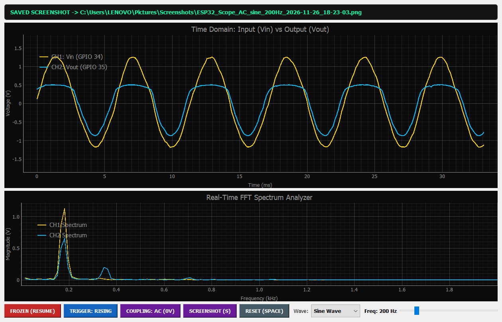
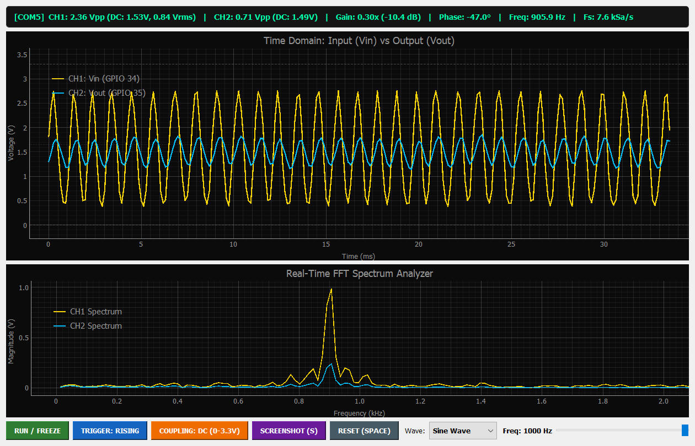
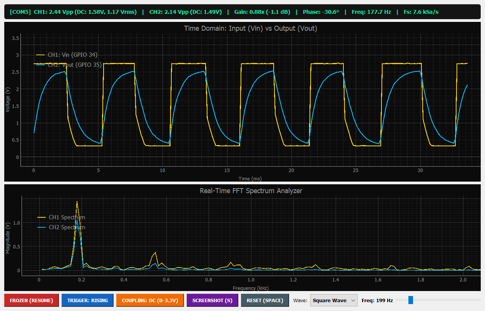
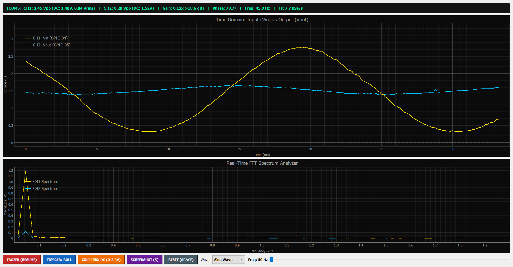
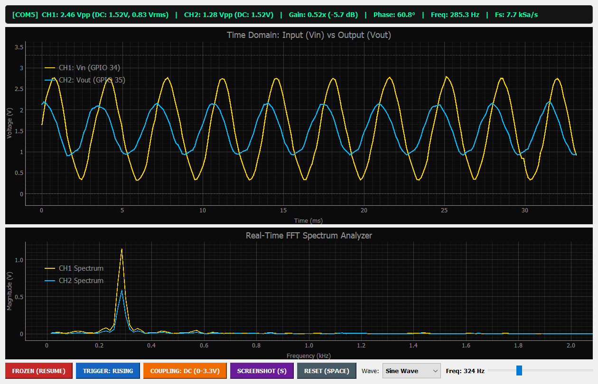
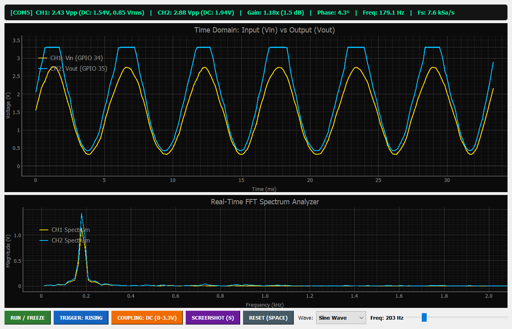
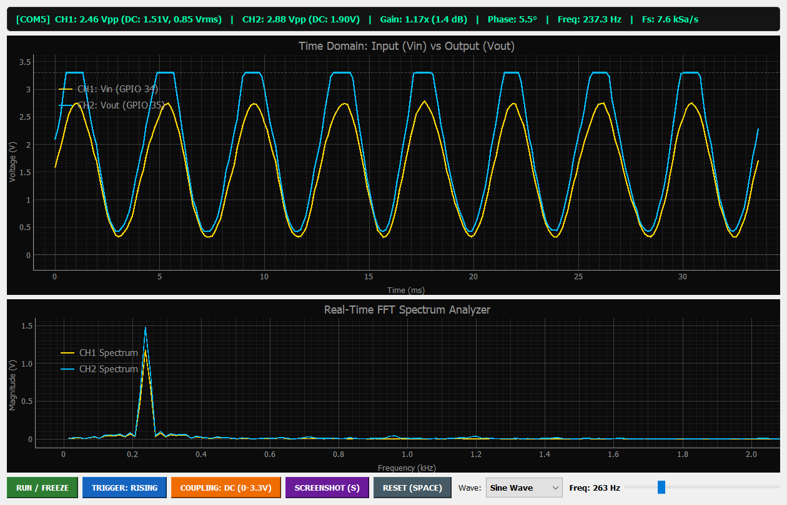

# esp32-dual-channel-oscilloscope
# DUAL-CHANNEL ESP32 OSCILLOSCOPE & REAL-TIME FFT ANALYZER

A breadboard-based Dual-Channel Digital Storage Oscilloscope (DSO) and Real-Time FFT Spectrum Analyzer built with an ESP32 DevKit, a 128x64 I2C SSD1306 OLED display, and a Python / PyQtGraph desktop GUI. Used to generate signals and verify four fundamental analog circuits.

Note: Circuits 1–4 were tested and verified. Circuit 5 (NE555P timer) was skipped following an onboard AMS1117 voltage regulator failure on the ESP32 DevKit.

How It Works

- Signal Generation (GPIO 25): Timer-driven ESP32 DAC function generator outputting selectable sine and square waveforms at adjustable frequencies.
- Dual-Channel Acquisition (GPIO 34 & GPIO 35): 12-bit ADC1 sampling (0–4095 codes, ADC_11db attenuation for 0–3.3 V) capturing 512-sample buffers at ~7.6–7.7 kSa/s and streaming binary frames at 921600 baud over serial.
- Real-Time Desktop GUI (PyQtGraph): Displays rising-edge-triggered time-domain plots (CH1 input vs. CH2 output), live Vpp, DC, Vrms, gain, and frequency readouts, and live FFT spectra.
- Dual-Core OLED Display (GPIO 21 SDA, GPIO 22 SCL): A FreeRTOS task pinned to Core 0 renders live CH1 and CH2 waveforms and Vpp values on a 128x64 SSD1306 I2C OLED without blocking Core 1 sampling.

Pinout

| Signal | ESP32 Pin | Role |
| --- | --- | --- |
| DAC Output | GPIO 25 | Waveform generator output |
| CH1 (Vin) | GPIO 34 | ADC1 input-only (0–3.3 V) |
| CH2 (Vout) | GPIO 35 | ADC1 input-only (0–3.3 V) |
| OLED SDA | GPIO 21 | I2C data |
| OLED SCL | GPIO 22 | I2C clock |
| Ground | GND | Common ground |

Circuits Tested & Verified

1. Adjustable Positive Diode Clipper
Clips positive peaks above an adjustable threshold set via a 1N4148 diode and potentiometer, introducing harmonics visible in the FFT plot.
- Measured sample (256.4 Hz): CH1 = 2.43 Vpp, CH2 = 1.49 Vpp, Gain = 0.61x (-4.2 dB)

2. RC Low-Pass Filter (R = 10 kΩ, C = 100 nF, fc ≈ 159.15 Hz)
Attenuates higher frequencies and produces exponential charging/discharging curves on square waves.
- Low-frequency attenuation (44.5 Hz sine): Gain = 0.87x (-1.2 dB)
- Cutoff region (163.7 Hz sine): Gain = 0.76x (-2.4 dB)
- Square wave (177.7 Hz): Gain = 0.88x (-1.1 dB) with exponential RC integration

3. RC High-Pass Filter (C = 100 nF, Dual 10 kΩ Mid-Rail Bias, Req = 5 kΩ, fc ≈ 318.31 Hz)
Biases the output near 1.65 V (3.3 V divider), attenuates low frequencies, passes high frequencies, and produces edge spikes on square waves.
- Low-frequency attenuation (45.0 Hz sine): Gain = 0.12x (-18.6 dB)
- Cutoff transition (285.3 Hz sine): Gain = 0.52x (-5.7 dB)
- Square wave differentiator (133.1 Hz): Gain = 1.00x (0.0 dB) with sharp edge spikes

4. LM358 Non-Inverting Amplifier (Rf = 2.2 kΩ, Rg = 10 kΩ, Design Av = 1.22x)
Amplifies CH2 over CH1 in a non-inverting configuration powered from the 5 V rail with common ground.
- Measured sample (179.1 Hz sine): CH1 = 2.43 Vpp, CH2 = 2.88 Vpp, Gain = 1.18x (+1.5 dB)
- Measured sample (237.3 Hz sine): CH1 = 2.46 Vpp, CH2 = 2.88 Vpp, Gain = 1.17x (+1.4 dB)

Manual Calculations

See docs/manual_calculations.txt for full formulas and step-by-step equations.

Run Host GUI

cd host_gui
pip install -r requirements.txt
python scope_ui.py
